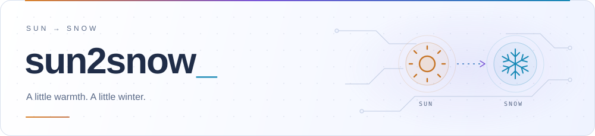

<picture>
  <source media="(prefers-color-scheme: dark)" srcset="assets/header-dark.svg" />
  <source media="(prefers-color-scheme: light)" srcset="assets/header-light.svg" />
  
</picture>

<h1 align="center">Hi, I'm sun2snow</h1>

Welcome to my little corner of GitHub.

## Featured Projects

### [QOJ-Translate ↗](https://github.com/sun2snow/QOJ-Translate)

Read QOJ problem statements in Chinese, right where they are. A Tampermonkey userscript that translates HTML and text-based PDFs through a Responses API-compatible service, while preserving formulas, code, and page structure where possible.

`HTML + PDF` · `In-page translation` · `Original / translated view`

[Explore the project →](https://github.com/sun2snow/QOJ-Translate#readme)

### [vr-oi-simulator ↗](https://github.com/sun2snow/vr-oi-simulator)

An OI exam room turns into a first-person 3D browser action game. Fight through 500 guards to reach the exit, with autosaved combat progress and optional simulated coding challenges. Played with a keyboard and mouse, not a VR headset.

`First-person 3D` · `500-guard challenge` · `Autosave`

[Explore the project →](https://github.com/sun2snow/vr-oi-simulator#readme)

## GitHub at a Glance

  <a href="https://github.com/sun2snow?tab=repositories">
    <picture>
      <source media="(prefers-color-scheme: dark)" srcset="https://raw.githubusercontent.com/sun2snow/sun2snow/output/stats-dark.svg" />
      <source media="(prefers-color-scheme: light)" srcset="https://raw.githubusercontent.com/sun2snow/sun2snow/output/stats-light.svg" />
      
    </picture>
  </a>
  <a href="https://github.com/sun2snow?tab=repositories">
    <picture>
      <source media="(prefers-color-scheme: dark)" srcset="https://raw.githubusercontent.com/sun2snow/sun2snow/output/languages-dark.svg" />
      <source media="(prefers-color-scheme: light)" srcset="https://raw.githubusercontent.com/sun2snow/sun2snow/output/languages-light.svg" />
      
    </picture>
  </a>

Public activity only · Refreshed daily · Language usage is not a measure of proficiency.

## Watch My Contributions Come Alive

<picture>
  <source media="(prefers-color-scheme: dark)" srcset="https://raw.githubusercontent.com/sun2snow/sun2snow/output/snake-dark.svg" />
  <source media="(prefers-color-scheme: light)" srcset="https://raw.githubusercontent.com/sun2snow/sun2snow/output/snake-light.svg" />
  
</picture>

---

From sun to snow, one commit at a time.

